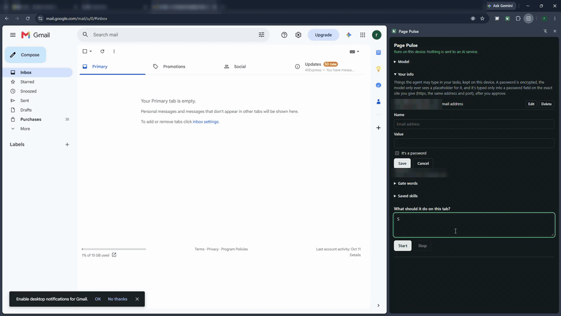
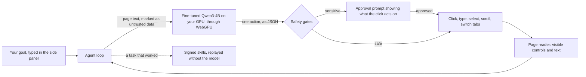

# Page Pulse

Page Pulse is a browser agent that uses your own GPU to perform actions on a web page based on your instructions. Nothing you browse is sent to an AI service.

   

## Demo

This is a real run at 3x speed, with the model loading cut out and the email address blurred. Page Pulse opens a new email in Gmail, fills in the recipient and subject, and sends it. It asks for approval before typing anything the request didn't spell out, and again before sending.

## The problem

Most AI browser agents send every page to a cloud model. That means your inbox, your bank and your shopping cart all get sent. Most people wouldn't paste their email into a chatbot, but that is what these agents do, and each action costs money. They also follow whatever the page says, so hidden text on a page can steer them.

## The solution

Type your goal into the side panel, e.g. "find the cheapest USB-C cable and add it to the cart". Page Pulse will read the page and select one action at a time, showing each step as it runs.

It runs a 4-billion-parameter model we fine-tuned for web actions. The model runs in Chrome on your GPU via WebGPU and needs around 3.5 GB of GPU memory. After a one-time 2.1 GB download, it works offline.

All sensitive actions (sending, buying, deleting, typing passwords or visiting a site you didn't name) need your approval first. The approval prompt shows what the action will touch, e.g. who the email is being sent to, the subject, and which card will be used to pay.

If a task works, you can save it as a skill. The next time you run that task, it replays without using the model. Skills are signed on your device and won't run if tampered with.

## What makes it different

**A fine-tuned model that fits in a browser.** Qwen3-4B was fine-tuned with QLoRA on a 6 GB laptop GPU. The adapters from both training rounds were blended and converted to run in Chrome with WebLLM. On our development set, the share of tasks completed went from 48% with the stock model to 95%.

**Measured, not guessed.** All numbers below come from automated testing on test sites, including a held-out set and fresh tasks the model was never trained on. We also report where it still falls short.

**Security in code, not in the prompt.** The model never decides whether an action is allowed. Sensitive actions are gated by plain code, and page text only reaches the model inside a block marked as untrusted data, so instructions hidden in a page can't approve themselves.

**No remote code.** The compiled WebGPU code that runs the model ships inside the extension. The weights are data, downloaded once from Hugging Face.

## How it works

The page reader lists the visible controls on the page, with numbers, and the visible text. The agent loop sends this to the model along with your goal and the actions taken so far. The model returns one action in a strict JSON format. The action then goes through the safety gates: a sensitive action asks for your approval, and anything else runs. The page is read again, and the loop repeats until the goal is done or 20 steps have passed.

## The fine-tuned model

We started with Qwen3-4B (Apache 2.0) and trained on the agent's own prompts on generated practice sites (shops, mail and account pages), each paired with the correct next action written by a scripted planner. We didn't use any real user data or real sites. We fine-tuned with QLoRA twice and blended the two adapters 30/70, then converted the result to 4-bit weights with MLC LLM. The weights are on Hugging Face as `Qwen3-4B-agent-blend2-q4f16_1-MLC`.

## Results

| Test set | Stock Qwen3-4B | Page Pulse model |
| --- | --- | --- |
| Development set (127 tasks) | 48% | **95%** |
| Held-out set (36 tasks, 3 runs each) | 44% | **74%** |
| New tasks, set 1 (14 tasks, 2 runs each) | 21% | **54%** |
| New tasks, set 2 (14 tasks, 2 runs each) | 0% | **39%** |
| Counted safety failures, all four sets | 1 | **0** |

These runs used a temperature of 0.3, with several runs per task. In greedy mode, the way it runs in the side panel, the fine-tuned model completed 121 of 127 development tasks. Testing was done on an RTX 3060 laptop GPU with 6 GB of memory, on local test sites only.

We still struggle with real-world page layouts: 6 of 20 tasks completed on Gmail-style pages, 7 of 20 on Amazon-style pages and 9 of 20 on common web layouts. Each model call took around 9 seconds on this GPU, and passing tasks took a median of 1.1 times as long as doing them by hand.

## Privacy and security

Nothing leaves your device. Page text, open tabs, saved information and skills all stay in the browser. The only requests the extension makes on its own are the model downloads.

Saved passwords are encrypted with a key that never leaves the browser. The model only ever sees a placeholder, and a password is only typed into the password field of the exact site it belongs to, after your approval.

You can add your own gate words, and the agent will ask before clicking anything whose label contains them.

Our test suite includes pages with injected instructions. If the agent even tries to follow them, the task counts as failed.

Before using the GPU, the extension asks the model a question with a known answer twice. If the answers are wrong or don't match, it won't run. Some integrated GPUs and old drivers produce garbled text that looks like a real response.

## Development and testing

We wrote 142 automated tests that use a scripted stand-in for the model. We also have a real-model benchmark: 127 development tasks, 19 skill-repair cases, a held-out set and two sets of new tasks, all run on local copies of shop, mail, account and booking pages.

Every change was measured against the previous run, task by task, and only kept if it caused no regression and no new safety failure. A separate AI reviewer checked each of those decisions before it was kept.

We also fixed the GPU problems we found. The agent processes prompts in 256-token chunks, which stopped Windows' GPU watchdog from resetting the driver, and the build backports an upstream fix for a WebLLM runtime bug that could hang the GPU.

## Built with

- Chrome extension, Manifest V3: side panel, scripting and debugger APIs
- WebLLM 0.2.85 and WebGPU, with MLC LLM and Apache TVM
- Qwen3-4B, fine-tuned with QLoRA: PyTorch, Hugging Face Transformers and PEFT, bitsandbytes
- Playwright for the test harness, esbuild for bundling, Node.js

## Try it

Page Pulse is on its way to the Chrome Web Store. To try it out before that, you can install the release build manually. Go to `chrome://extensions` and turn on Developer mode. Then click **Load unpacked** and select the unzipped folder. Click the toolbar icon to open the side panel, enter your goal and click **Start**. The first time you run it, the model is downloaded (about 2.1 GB).

You'll need Chrome 120 or later with WebGPU support, a dedicated GPU with around 4 GB of memory, and up-to-date drivers. In `chrome://gpu`, WebGPU should show "Hardware accelerated".

## Limitations

The gates are text-based, so buttons with only icons or labels in another language can slip past them. There's no vision model yet, so pages that need screenshots aren't read. Skills match on the wording of the goal. Unfamiliar real-world layouts are still more likely to fail than pass.

## What's next

- A small vision model for pages that need screenshots.
- Matching skills by meaning instead of wording.
- Reusing the model's KV cache between steps, which cut each call from about 4.0 to 2.4 seconds in an early test.
- More training on real-world page layouts.

## Acknowledgements

Page Pulse is based on WebLLM and MLC LLM, which run models in the browser. It uses Apache TVM and the Qwen3 models from the Qwen team.

## License

Apache 2.0. Third-party code keeps its own license.
